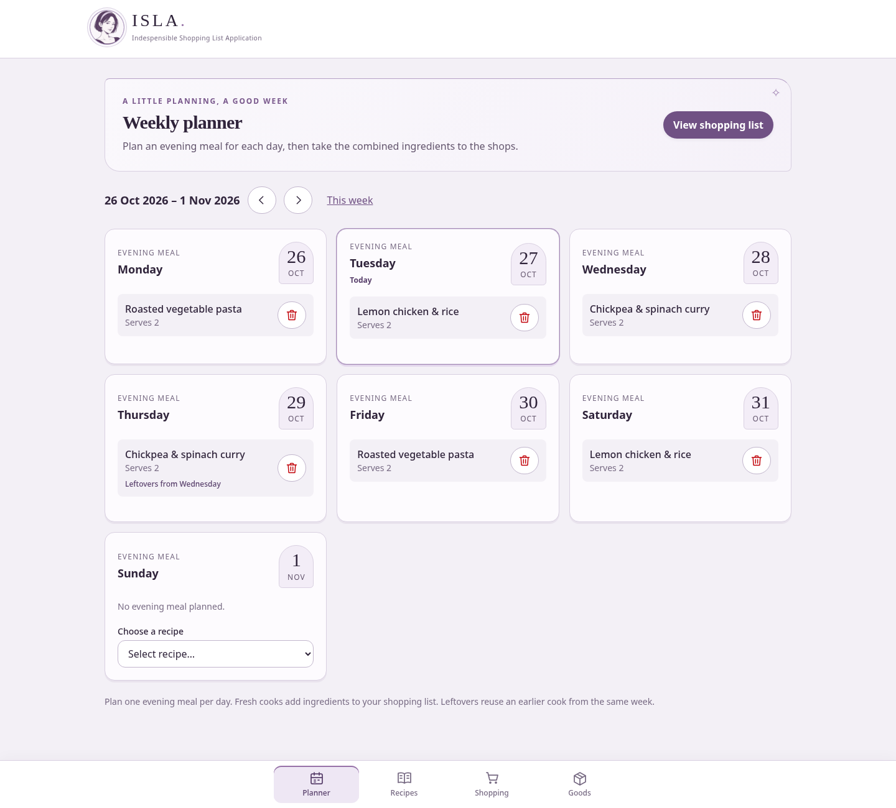
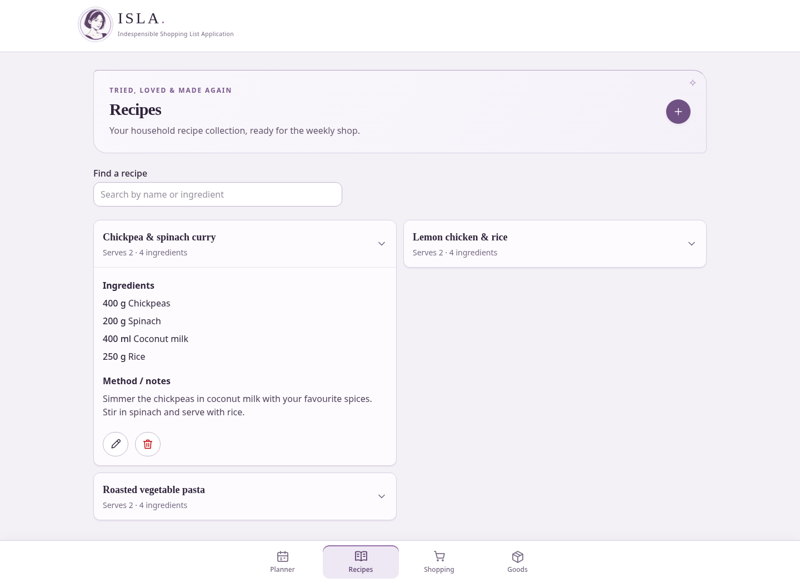
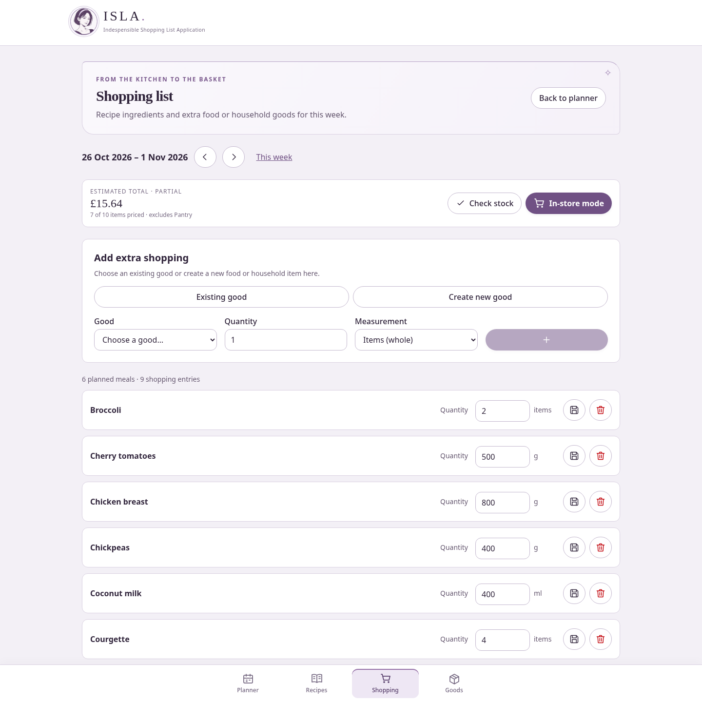
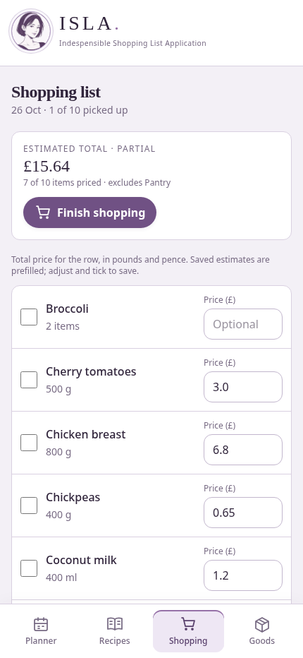

# ISLA

**Indespensible Shopping List Application**

ISLA is a self-hosted meal planner and shopping list for a shared household. Save recipes, plan the week's meals, and turn ingredients and household extras into one shopping list.

- Plan evening meals and reuse leftovers.
- Keep a searchable collection of recipes and food or household goods.
- Combine ingredients into a weekly shopping list and mark items already in stock.
- Use a mobile shopping checklist to record purchases and prices.
- Share your household with administrator and member accounts.
- Choose JSON or SQLite storage, with household export and import.

ISLA uses .NET 10 Blazor with server interactivity and Tailwind CSS 4. A connection to your ISLA server is required while using the app.

## Screenshots

Screenshots use sample household data.

### Weekly planner



### Recipes



### Shopping list



### In-store mode on mobile



## Quick start with Docker

Install Docker, then start ISLA with a persistent data volume:

```sh
docker run -d --name isla -p 8080:8080 \
  -v recipe-data:/app/data \
  ghcr.io/j35p1n/isla:latest
docker logs isla
```

Open http://localhost:8080. Enter the token printed after `ISLA first-run setup token:` in the logs, create your administrator account, and choose your storage option. If the container restarts before setup completes, use the latest token. Setup closes once the installation is initialised.

The image supports AMD64 and ARM64. Use `ghcr.io/j35p1n/isla:sha-<full-commit-sha>` to pin a deployment to a specific build.

For access outside your local machine, serve ISLA over HTTPS through a reverse proxy with WebSockets enabled. Configure trusted forwarded headers for your hosting environment. See the [administration guide](docs/administration.md) for configuration, recovery, and backup instructions.

### Build with Docker Compose

To build from source instead of using the published image:

```sh
git clone https://github.com/J35P1N/ISLA.git
cd ISLA
docker compose up --build -d
docker compose logs isla
```

Open http://localhost:8080 and complete setup using the token from the logs. Stop the application with `docker compose down`; its data volume is retained.

### Run from source

Install the .NET 10 SDK and Node.js 24 LTS, including npm. From a clone of this repository:

```sh
dotnet build ISLA.sln
dotnet run --project src/ISLA --launch-profile http
```

Open http://localhost:5080 and use the first-run token from the server console to complete setup. The build installs the required npm dependencies when missing and compiles the stylesheet automatically.

See the [development guide](docs/development.md) for live reload, release builds, project layout, and tests.

## Storage and backups

Each installation has one shared household. Both storage options provide the same features:

| Option | Storage | Requirements |
| --- | --- | --- |
| **Simple — JSON** | Household data in JSON files | One application instance and a local persistent directory or Docker volume |
| **Medium — SQLite** | Data in a SQLite database; no database server needed | One application instance and a local persistent directory or Docker volume |

Choose either option during setup. Neither supports multiple application replicas or shared network storage.

Docker stores data in `/app/data`; the examples above preserve it in the `recipe-data` volume. When running from source, the default directory is `src/ISLA/App_Data`. Set `DataDirectory` to use a different location.

Administrators can export household data from **Settings** and import it into an empty household. Exports include recipes, goods, plans, shopping items, purchases, and prices, but exclude accounts and sign-in data.

For a complete backup, stop ISLA and back up the entire data directory or volume, including accounts and encryption keys. Back up before upgrading. **`docker compose down --volumes` permanently deletes the deployment's data volumes.** See [backup and restore instructions](docs/administration.md#complete-docker-backup-and-restore).

## Using ISLA

### Recipes and meal planning

Add recipes with servings, ingredients, and optional instructions. Ingredient names are shared across recipes and added to the goods catalogue automatically. Measurements support item counts and UK metric/imperial cooking units.

The planner shows a Monday–Sunday week. Choose a recipe for each evening meal, or use leftovers from an earlier cook that week. Leftovers do not add ingredients to the shopping list. Navigate between weeks to plan ahead.

### Goods and extra shopping

Use **Goods** to manage food and non-food items such as toiletries and cleaning supplies. Only food goods appear in recipe ingredient suggestions.

Under **Shopping list → Add extra shopping**, search for an existing good and choose its quantity and measurement. You can also choose **Create new good** to save a new item and add it directly to the week's list.

The shopping list combines recipe ingredients and extras with matching names and measurements. Kilograms combine as grams and litres as millilitres; other measurements stay separate. Adjusting or removing a shopping-list row applies only to that week and does not change your recipes.

### Check stock

Enable **Check stock** and mark items **In stock** to move them into the week's **Pantry** section. Return them to the shopping list with the plus button. Stock choices apply to the selected week rather than tracking ongoing household inventory.

### Shopping and prices

Enable **In-store mode** for a mobile checklist. Enter an optional total price for a row before ticking it as purchased. **Finish shopping** returns to the normal list, where purchases appear in a separate section.

ISLA remembers prices to estimate future shopping costs. Estimates show how many items have known prices and are labelled partial when some prices are missing.

The browser remembers in-store mode, its selected week, and unfinished price entries when browser storage is available. Prices entered for unchecked items become part of the household's price history when you mark those items as purchased.

### Accounts

Everyone signs in to access the shared household; there is no public registration. Administrators create and manage accounts in **Settings**. The **Account** menu in the bottom navigation provides settings and sign out, and every user can change their own password.

See the [administration guide](docs/administration.md) for password recovery, storage transfers, and deployment configuration.

## Licence

ISLA is available under the [MIT licence](LICENSE).
