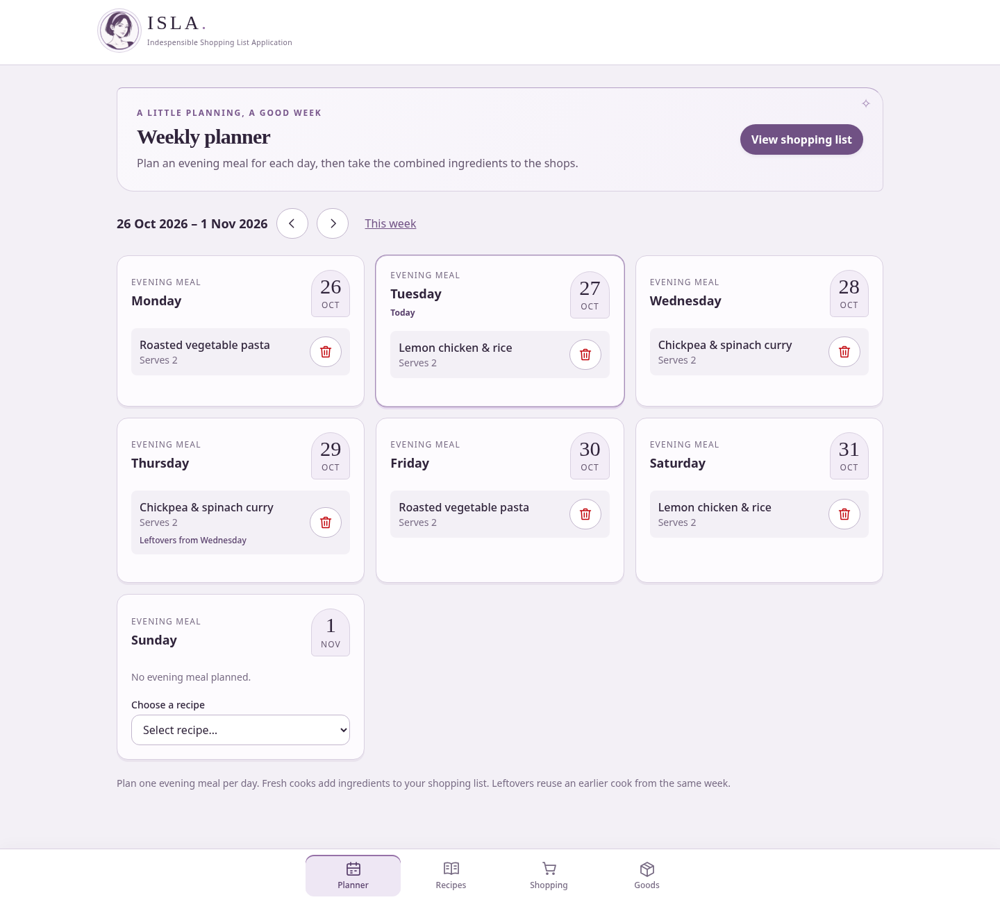
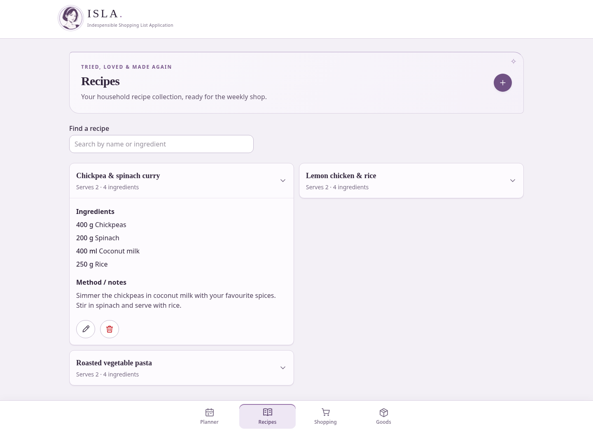
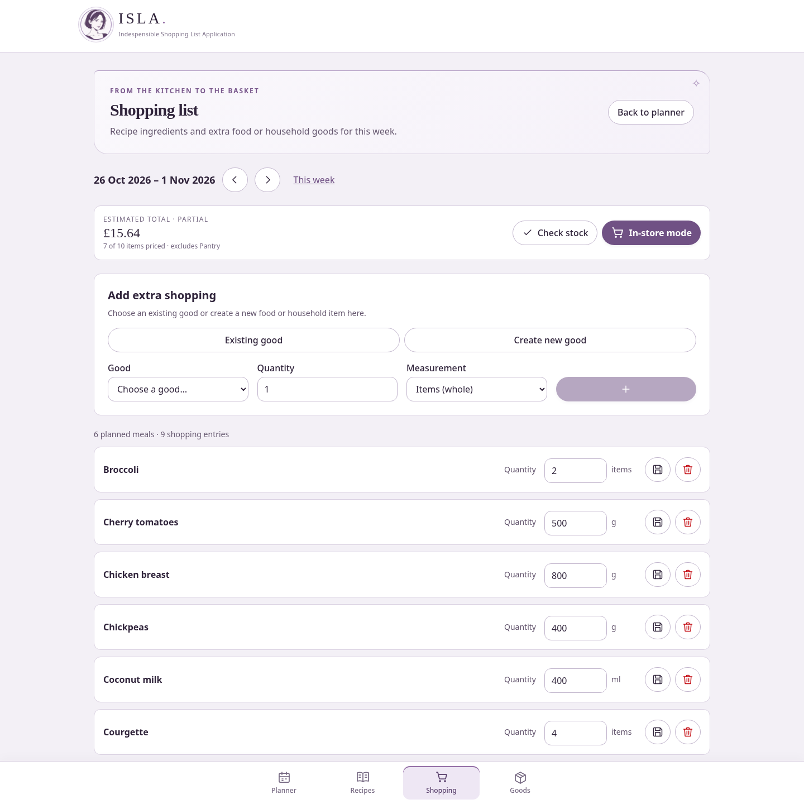
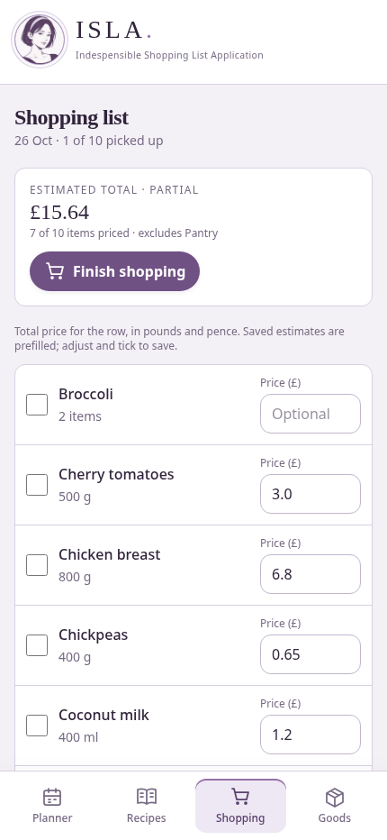

# ISLA

**Indespensible Shopping List Application**

.NET 10 Blazor Web App based on the standard template, with server interactivity and Tailwind CSS 4. The application has a dedicated Recipes section for managing a shared household recipe collection.

## Screenshots

Screenshots use sample household data.

### Weekly planner

Plan the week's evening meals and reuse leftovers from earlier cooks.



### Recipes

Keep a shared collection of recipes and their ingredients.



### Shopping list

Combine recipe ingredients, check the pantry, and track estimated costs.



### In-store mode on mobile

Tick off purchases and record prices while shopping.



## Layout

```text
ISLA.sln        Solution
src/ISLA/       Blazor application
  Components/              Layout, navigation, and Razor pages
  Styles/app.css           Tailwind entry point and Blazor state styles
  wwwroot/                 Static assets (app.css is generated)
  package.json             CSS build and watch commands
Dockerfile                 Multi-stage Node/.NET build and non-root runtime
compose.yaml               Local production container
```

## Choose storage

Each installation has one shared household. Both supported storage options provide the same household features, administrator/member accounts, and household export/import.

| Option | Storage | Suitable deployment |
| --- | --- | --- |
| **Simple — JSON** | Household data in `recipes.json`; accounts and sessions in separate private files | One application instance on a local persistent directory or Docker volume |
| **Medium — SQLite** | Household data, accounts, and sessions in `isla.db`; no separate database server required | One application instance on a local persistent directory or Docker volume |

The standard Docker instructions below let you choose either option during setup. To fix SQLite through deployment configuration, use the [SQLite instructions](#sqlite-storage-stage-2). Choosing SQLite is optional; JSON remains supported and existing JSON installations keep their provider. Neither option supports multiple replicas or shared network storage.

## Run locally

Install Git, the .NET 10 SDK, and Node.js 24 LTS (including npm).

Clone the repository:

```sh
git clone https://github.com/J35P1N/ISLA.git
cd ISLA
```

Build and launch the application from the repository root:

```sh
dotnet build ISLA.sln
```

Launch ISLA:

```sh
dotnet run --project src/ISLA --launch-profile http
```

On an unconfigured installation, ISLA generates a random first-run setup token and prints `ISLA first-run setup token: ...` in the server console. Enter it on the setup page. It stays in memory, changes if the process restarts before setup completes, and is rejected once setup completes. Configured installations do not generate or print another token.

Operators can instead supply `Setup__Token` or `Setup__TokenFile` (a restricted mounted secret file). Supplied tokens are never printed. Never put tokens in URLs or committed files.

Setup verifies the token, asks for administrator credentials, offers **Simple JSON** or **Medium SQLite** storage, validates the data directory, then shows a final review before initialisation. Deployment configuration can fix the provider in advance.

Open http://localhost:5080. The .NET build automatically installs locked npm dependencies when missing and compiles Tailwind before static assets are discovered. Commit `package-lock.json` when dependencies change; run `npm ci --prefix src/ISLA` to synchronize an existing install.

For HTTPS, trust a development certificate with `dotnet dev-certs https --trust`, then select `--launch-profile https` (https://localhost:7080).

For development with automatic updates, run these in separate terminals:

```sh
npm run css:watch --prefix src/ISLA
dotnet watch --project src/ISLA --launch-profile http
```

Edit `Styles/app.css` for theme/global styles and use Tailwind utilities directly in Razor components. Class scanning is explicitly scoped to `Components/`; use complete class names so Tailwind can discover them. The template reconnect component keeps its isolated CSS for Blazor connection state transitions.

## Build and publish

```sh
dotnet build ISLA.sln -c Release
dotnet publish src/ISLA -c Release
```

Both commands generate minified CSS. Generated CSS, build outputs, and npm dependencies are ignored by source control. `SkipTailwind=true` is reserved for pipelines that have already generated `wwwroot/app.css`, such as the Docker build.

## Docker

Start Compose and read the generated first-run token:

```sh
docker compose up --build -d
docker compose logs isla
```

Enter the value after `ISLA first-run setup token:` on the setup page. If the container restarts before setup completes, use its latest token. Completed installations stay closed to initial setup and do not print another token. For an operator-managed token, set `ISLA_SETUP_TOKEN` before starting Compose; it is passed as `Setup__Token` and is never printed.

Open http://localhost:8080. Stop with `docker compose down`.

Or build and run directly:

```sh
docker build -t isla .
docker run --rm -p 8080:8080 -v recipe-data:/app/data \
  -e Setup__Token="$ISLA_SETUP_TOKEN" isla
```

The build uses `npm ci` and separate Node/.NET SDK stages. Only the published application and ASP.NET runtime enter the final image, which runs as the built-in non-root app user on port 8080.

For deployment, terminate TLS at your ingress/reverse proxy and enable WebSockets for interactive server components. Configure trusted forwarded headers for your hosting environment before HTTPS redirection if the proxy forwards requests over HTTP. Data Protection keys persist in the private data volume so logins survive container replacement. JSON and SQLite modes support exactly one running instance; it refuses another process using the same directory. Supply environment-specific settings through environment variables or your deployment's secret store.

References: [Tailwind CLI](https://tailwindcss.com/docs/installation/tailwind-cli), [.NET container ports and users](https://learn.microsoft.com/dotnet/core/docker/introduction).

## Automated builds and published images

Pull requests targeting `master` and pushes to `master` run the Release build, .NET and JavaScript tests, and container startup checks for both AMD64 and ARM64. Container checks verify the first-run setup page and Blazor assets, then run Chromium acceptance tests for both providers, container replacement, stopped-volume backup/restore, authorization and household transfers. Test reports are available as workflow artifacts for seven days.

After these checks pass on `master`, GitHub Actions publishes `ghcr.io/j35p1n/isla:latest` and `ghcr.io/j35p1n/isla:sha-<full-commit-sha>`. Each tag supports both architectures; Docker selects the appropriate image. Pull requests do not publish images or receive registry credentials. The workflow uses the repository's built-in `GITHUB_TOKEN`; no personal access token is required. The workflow can also be run manually; publishing is restricted to `master`.

Once the package has been published and made public, launch a prebuilt image:

```sh
docker pull ghcr.io/j35p1n/isla:latest
docker run -d --name isla -p 8080:8080 \
  -v recipe-data:/app/data -e Setup__Token="$ISLA_SETUP_TOKEN" \
  ghcr.io/j35p1n/isla:latest
```

Read the generated first-run token with `docker logs isla`, open http://localhost:8080, and enter it to begin setup. Alternatively, supply `ISLA_SETUP_TOKEN` before starting the container; explicit tokens are never printed. See the Docker section for storage and deployment requirements. Stop and remove this container with `docker stop isla` followed by `docker rm isla`; the data volume is retained. Use the commit-specific tag when you need to pin a deployment to a particular build.

### Repository owner configuration

Enable GitHub Actions and allow the pinned actions used by `.github/workflows/ci.yml`. After the first successful publication, open your GitHub profile's **Packages → isla → Package settings → Change visibility** and select **Public**. Package visibility is separate from repository visibility; public packages allow anonymous pulls. If an `isla` package already exists, grant this repository Actions write access in that package's settings before publishing. See [GitHub's container registry documentation](https://docs.github.com/en/packages/working-with-a-github-packages-registry/working-with-the-container-registry).

Protect `master` with a ruleset requiring pull requests and the **Build and test**, **Container (amd64)** and **Container (arm64)** checks. Keep approval requirements for workflows from outside contributors. Actions are pinned to commit hashes, and Dependabot checks those pins weekly.

Before making the repository public, review the complete Git history, commit email addresses, existing Actions logs and artifacts, and repository/environment secrets. Existing workflow logs become public with the repository. Enable secret scanning, push protection and private vulnerability reporting where available. The project includes an MIT licence; keep runtime data, tokens and deployment credentials outside source control.

## Recipes and persistence

Open **Recipes** to add, search, edit, and delete recipes. Each recipe has a name, servings, ingredients, and optional method/notes. Ingredient names are reused case-insensitively across recipes; enter a new name or choose from the input suggestions. Saving a recipe adds its ingredients to the shared catalogue. Deleting a recipe keeps those names available.

Use whole-number quantities for individual items. Measurements support decimal values and UK metric/imperial cooking units: g, kg, ml, l, tsp, tbsp, oz, lb, fl oz, pint, and pinch. Measurements are stored as entered; automatic unit conversion is not performed.

In JSON mode, household data is stored in `App_Data/recipes.json` by default, outside the static web root and ignored by Git. SQLite uses `isla.db` in the same data directory instead. Override the directory with the `DataDirectory` environment variable. JSON writes are serialized and replace the file atomically. The process holds an exclusive directory lock for its lifetime; use a local filesystem with reliable locking, not a shared network filesystem. This lightweight file store supports a single running application instance shared by the household; simultaneous edits of the same recipe use the last saved version. SQLite also requires one instance and a local filesystem; support for multiple instances is reserved for later external-database stages.

Docker Compose mounts the `recipe-data` named volume at `/app/data`. It survives container replacement and `docker compose down`; `docker compose down -v` removes it. Back up this volume (or the local data directory) to protect your collection. A direct `docker run` should also mount a volume with `-v recipe-data:/app/data`.

Everyone must sign in to access the shared household. Administrators create accounts in Settings; there is no public registration. The opening page shows a Monday–Sunday calendar for the current UK week. Add one saved recipe per day for the evening meal. The same recipe can be planned on different days. Remove a planned meal using its trash icon to choose a replacement. Existing days with multiple meals remain visible so they can be removed without losing saved data. Navigate between weeks to plan ahead. Plans are persisted with the recipe collection.

The Shopping list page totals ingredients for the selected week. Each meal uses the full recipe quantities; matching names (case-insensitive) and units are added together. Kilograms convert to grams and litres to millilitres before combining; other units remain separate. Recipe edits update future shopping-list calculations; deleting a recipe also removes its planned meals. Existing recipe files are compatible and begin with an empty plan.

## Accounts, backup and recovery

The monogram labelled **Account** in the bottom navigation opens your signed-in profile and **Sign out**. Administrators see **Settings** for household administration; members see **Account settings** for their own password. Settings lets every user change their password. Administrators can create accounts, change Administrator/Member roles, disable accounts, reset passwords and revoke all of a user's sessions. The last active administrator cannot be disabled or demoted. Password changes, resets, role changes and disabling an account revoke its existing sessions. Open interactive pages revalidate each minute, and every household operation checks its session immediately. ASP.NET Core Identity handles password hashing, validation and lockout through a transaction-scoped storage adapter shared by JSON and SQLite. Existing password hashes and the 12–256 character password policy remain compatible. Five failed password attempts lock the account for 15 minutes.

**Remember this browser** uses a fixed 90-day expiry from sign-in, with no sliding extension. Unchecked logins use a session cookie and a maximum server lifetime of 24 hours. Logout revokes the current session. HTTPS is required for deployed use; terminate TLS at your trusted reverse proxy or configure HTTPS directly.

In JSON mode, the private data directory contains `recipes.json`, `identity.json` (password hashes and revocable sessions), `installation.json`, and `keys/` (Data Protection keys). Unix files are restricted to their owner. Keep the entire directory private, writable by the application user, and backed up together while ISLA is stopped. Existing household files are preserved during setup, with a `recipes.json.pre-setup.bak` backup. Invalid or missing configured files show an HTTP 503 recovery page rather than reopening setup or replacing data. Do not edit these files while ISLA is running.

Admin **Settings → Export household** downloads a versioned JSON export of recipes, goods, plans, extras, overrides, pantry, purchases and prices. Accounts, hashes, browser sessions, secrets and keys are excluded. **Import** validates the export and accepts only an empty household, with a 10 MB limit. Failed validation leaves the destination unchanged. To move between JSON and SQLite: export, stop/reconfigure/restart into an empty destination, initialise its administrator, then import. Keep the old volume until the import is verified; recreate member accounts at the destination.

For a forgotten administrator password, stop ISLA first and create a restricted file containing the new password (12–256 characters). Run the operator command against the same data directory:

```sh
ISLA_RESET_USERNAME=admin ISLA_RESET_PASSWORD_FILE=/private/new-password \
dotnet run --project src/ISLA --no-launch-profile -- --reset-admin
```

For a container, with the normal service stopped:

```sh
docker compose run --rm --no-deps -e ISLA_RESET_USERNAME=admin \
  -e ISLA_RESET_PASSWORD_FILE=/run/secrets/reset-password \
  -v /private/new-password:/run/secrets/reset-password:ro isla --reset-admin
```

The command resets and re-enables the existing administrator and revokes all of their sessions. Supply `DataDirectory` when using a custom location, ensure the process user can read the password file, and remove that file afterwards. Members ask an administrator to reset their passwords. No email service is required.

For operator-managed mounted configuration, set `ISLA_CONFIG_FILE` to a read-only, restricted JSON file outside the web root, for example `{"DataDirectory":"/app/data","Setup":{"TokenFile":"/run/secrets/isla-setup-token"}}`. Environment variables and command-line arguments override that file. These storage settings are read-only in the UI and changes require a restart. Credentials must stay in restricted files or injected environment secrets.

## SQLite storage (Stage 2)

Choose **Medium — SQLite** during first-run setup, or set `Storage__Provider=Sqlite` in the environment (`Storage:Provider` in JSON configuration). With no deployment override, the wizard saves the choice in the private `storage.json` file. The environment, command line, and operator-mounted configuration take precedence and make the provider field read-only in setup and Settings. JSON remains the default for existing installations.

When manually testing separate installations on the same browser address, close old ISLA tabs and load `/login` afresh after switching. Submitting a form rendered by the previous installation can fail antiforgery validation because the stores have different keys or signed-in identities.

SQLite uses EF Core with separate relational tables for recipes and ingredients, goods, meals and leftovers, extras, overrides, pantry, purchases, prices, accounts, sessions, and installation state. Transactions lock before reading the latest state, then commit the complete business operation together. Case-insensitive normalized catalogue keys, foreign keys, and unique constraints protect relationships. Quantities and prices retain exact decimal values; dates retain their calendar day. Decimal textual formatting may change during transfer (for example `2` becomes `2.0`), without changing the value. Simultaneous saves of the same recipe retain the last saved version, as in JSON mode.

The database lives at `DataDirectory/isla.db`; `sqlite-installation.json` records that the database has been created so a missing database triggers recovery. Accounts and sessions are in SQLite, separate from household export data. Keep the complete directory, including `storage.json`, `sqlite-installation.json`, `keys/`, and any SQLite journal/WAL files. **Stop ISLA before copying or restoring a backup.** Back up before upgrades. SQLite must use a **local persistent Docker volume**, not NFS, SMB, a shared network filesystem, or multiple application instances. The exclusive directory lock also applies to setup, upgrade, and recovery commands.

For a new Compose deployment with the provider fixed by the operator, install Docker Engine/Desktop with the Compose plugin, clone this repository, and run these commands from its root:

```sh
docker compose -f compose.yaml -f compose.sqlite.yaml up -d --build
docker compose -f compose.yaml -f compose.sqlite.yaml logs isla
```

Open http://localhost:8080 and enter the latest generated setup token from the logs. Create an administrator with a password of 12–256 characters, confirm the fixed SQLite provider, validate, review, and initialise. Sign in and check **Settings → Household storage → Active provider: Sqlite**. No SQLite installation on the host or database connection string is needed.

Use the same Compose files for subsequent commands:

```sh
# Stop and remove the container, retaining its data volume:
docker compose -f compose.yaml -f compose.sqlite.yaml down

# Recreate the container using the existing store:
docker compose -f compose.yaml -f compose.sqlite.yaml up -d

# Inspect startup or recovery messages:
docker compose -f compose.yaml -f compose.sqlite.yaml logs isla
```

Keep the same Compose project name and volume when restarting or upgrading. A different checkout directory can change the default project name and create a separate empty volume; use `--project-name` consistently if you set it explicitly. After setup, container replacement should retain accounts, data, and remembered sign-ins without reopening setup.

Both Compose modes mount `recipe-data` at `/app/data`, which survives container recreation. Do not use `down -v` when retaining data. The SQLite override selects the provider; it does not migrate or delete JSON files. For mounted configuration, include `"Storage":{"Provider":"Sqlite"}` in the restricted configuration file. The wizard verifies writable access but never provisions volumes.

To transfer an existing JSON household:

1. Sign in as an administrator and export from **Settings → Export household**. Keep a stopped backup of the old volume.
2. In **Settings → Household storage**, select SQLite and save. This schedules a change for the next restart; the running process continues using JSON. If deployment configuration controls the provider, change that configuration instead.
3. Restart ISLA. The SQLite destination must be empty. Complete setup with its administrator and import the saved household export. Accounts and sessions are deliberately not transferred; recreate other users.
4. Verify recipes, plans, shopping, stock and prices, and keep the original store until satisfied. ISLA never deletes the previous JSON files.

For a new destination directory or volume, configure `DataDirectory` and `Storage__Provider` before startup, initialise, then import. Moving back to JSON requires a new empty directory if the original JSON files are still present. Settings refuses to overwrite existing destination files. To roll back using the retained original store, stop ISLA, restore its complete backup or explicitly select its provider in deployment configuration, and restart. Changes made in SQLite are not automatically copied back.

New SQLite schemas are created in a staging file during wizard validation and published only after migrations and the installation row are complete. Interrupted staging files are discarded on retry; published schemas can resume administrator setup without creating duplicate accounts. Existing schemas are validated at startup and **never upgraded automatically**. Unknown, missing or damaged configured storage returns HTTP 503 recovery without falling back to JSON or reopening setup. After backing up and stopping the service, apply supported schema migrations explicitly:

```sh
Storage__Provider=Sqlite DataDirectory=/private/isla-data \
dotnet run --project src/ISLA --no-launch-profile -- --upgrade-storage

# With the normal Compose service stopped:
docker compose -f compose.yaml -f compose.sqlite.yaml run --rm --no-deps isla --upgrade-storage
```

Restart the service after a successful upgrade. The initial Stage 2 schema has one migration, so this command also checks an already current database. A future schema requires a compatible ISLA release; never edit migration history or reset an installation to work around recovery. Administrator password recovery uses the same `--reset-admin` command described above. For operator-controlled SQLite, stop the service and include its override in the recovery command:

```sh
docker compose -f compose.yaml -f compose.sqlite.yaml down
docker compose -f compose.yaml -f compose.sqlite.yaml run --rm --no-deps \
  -e ISLA_RESET_USERNAME=admin \
  -e ISLA_RESET_PASSWORD_FILE=/run/secrets/reset-password \
  -v /private/new-password:/run/secrets/reset-password:ro isla --reset-admin
docker compose -f compose.yaml -f compose.sqlite.yaml up -d
```

Replace `admin` with your existing administrator username. The password file must be readable by the container's normal application user; run recovery as that user, rather than overriding it with root. Remove the password file after successful recovery.

MongoDB, PostgreSQL and SQL Server remain future stages and cannot be selected yet.

## Complete Docker backup and restore

Household export is useful for transferring between providers, but it does not back up accounts, sessions, or encryption keys. For disaster recovery, stop ISLA and archive its **entire data volume**. These steps work for both JSON and SQLite.

The example below assumes a source Compose project named `isla`, whose volume is `isla_recipe-data`. Replace those two names with your actual project and volume names. Use `docker volume ls` and inspect your application container’s mounts to identify its data volume. Do not guess the source volume name: Docker can create an empty volume if it does not exist.

From the repository root, build a utility image, create a private backup directory, stop the source, and archive it:

```sh
docker build -t isla:backup-tools .
mkdir -p "$HOME/isla-backups"
chmod 700 "$HOME/isla-backups"
docker compose --project-name isla -f compose.yaml down
docker volume inspect isla_recipe-data
docker run --rm --user 0:0 --entrypoint tar \
  --mount type=volume,source=isla_recipe-data,target=/source,readonly \
  --mount type=bind,source="$HOME/isla-backups",target=/backup \
  isla:backup-tools -czf /backup/isla-backup.tar.gz -C /source .
tar -tzf "$HOME/isla-backups/isla-backup.tar.gz"
docker compose --project-name isla -f compose.yaml up -d
```

For operator-controlled SQLite, include `-f compose.sqlite.yaml` after `-f compose.yaml` in each Compose command above. Keep any other deployment overrides as well. The archive name is reused by these commands; choose a new filename for each backup you intend to retain. Store a copy away from the Docker host. The archive contains sensitive account data and keys.

To exercise recovery, stop the source again to free port 8080. Restore into a **new, empty** project named `isla-restore`; the following example uses operator-controlled SQLite:

```sh
docker compose --project-name isla -f compose.yaml -f compose.sqlite.yaml down
docker compose --project-name isla-restore -f compose.yaml -f compose.sqlite.yaml create --build
docker run --rm --user 0:0 --entrypoint tar \
  --mount type=volume,source=isla-restore_recipe-data,target=/destination \
  --mount type=bind,source="$HOME/isla-backups",target=/backup,readonly \
  isla:backup-tools -xzpf /backup/isla-backup.tar.gz -C /destination
docker compose --project-name isla-restore -f compose.yaml -f compose.sqlite.yaml up -d
```

For a JSON backup, omit `-f compose.sqlite.yaml` from those commands. Use an application image compatible with the backed-up schema. Root is used only by the archive helper to preserve file ownership; the application continues to run as its normal non-root user. Never extract a backup over a running or populated installation.

Open http://localhost:8080, sign in with the backed-up administrator credentials, and verify the active provider, recipes, plans, and shopping data. Setup should remain closed. After checking the restore, stop it and restart the source using its original Compose files. Keep the backup until recovery has been verified.

`docker compose down` retains data. **`docker compose down --volumes` permanently deletes that project's data volumes**; use it only when intentionally removing an installation. Removing a container or image alone does not remove its named data volume.

## Goods and extra shopping

Goods is the shared catalogue for food and non-food items, with no quantities. Existing ingredients migrate automatically to food goods. Saving a new recipe ingredient adds a food good. Only food goods appear in recipe suggestions, and saving a recipe with a known non-food good is rejected. A good used in recipes cannot be changed to non-food until removed from those recipes.

Add household goods such as toilet roll or bleach in **Goods** and choose **Non-food**. In **Shopping list**, select a good, quantity, and measurement under **Add extra shopping**. Extras are saved per week and included in the combined totals, alongside any recipe quantities for the same food. Edit quantities and remove items directly on the combined shopping-list rows. Goods categories can be changed in the catalogue, and names are unique ignoring case.

You can also select **Create new good** directly on the Shopping list, enter its name, choose Food or Non-food, and set a quantity and measurement. **Create and add to list** saves both the catalogue good and the selected week's extra item together. Existing names are rejected without changing their category; select them under **Existing good** instead.

Shopping-list rows have **Save** and **Remove** actions. These persist a final quantity (or hide the row) for that week without modifying recipes, meals, or the goods catalogue. Saved quantities remain fixed even if the plan changes. Adding an existing good as extra shopping clears that good/measurement override so it reappears with its new calculated total.

## Mobile layout

The primary navigation is a fixed bottom bar with icons, short labels, and an active-page highlight. Content reserves room for the bar and the device safe area. Controls have a minimum 44px touch height and inputs use 16px text. Shopping entries stack into cards on phones; forms, week navigation, and recipe cards adapt to wider screens.

The visual theme uses muted lavender, plum ink, and ivory colours with system serif headings and an original plum-and-ivory illustrated ISLA mascot. Theme tokens and reusable visual styles live in `Styles/app.css`; no external fonts or image services are required.

### ISLA identity

The interface and browser titles use ISLA — Indespensible Shopping List Application. The original mascot uses a restrained monochrome portrait in plum and ivory, combining classical editorial linework with a modern manga silhouette. The header uses `src/ISLA/wwwroot/images/isla-mascot.webp` (256px); `isla-mascot.png` is the full-resolution source, and `wwwroot/favicon.png` is the 64px browser icon. The muted lavender, plum, and ivory palette remains consistent across the app.

### Leftovers

Selecting a recipe already cooked earlier in the same Monday–Sunday week offers **Use leftovers** or **Cook fresh**. Fresh cooks add another full recipe to the shopping list; leftovers reference the earlier cook and add no ingredients. Earlier weeks and later days do not qualify. The planner labels leftover meals with their cooking day. If the original cook is removed, the first dependent leftover becomes a fresh cook and later leftovers use that meal, keeping ingredients accounted for.

### Check stock and Pantry

Enable **Check stock** on the Shopping list for a simplified view without quantity editing or extra-item forms. Mark items **In stock** to exclude them from the shopping list and show them in the compact **Pantry** section. Its plus buttons return items to the shopping list. Stock choices persist for the selected week, apply to the whole listed quantity, and distinguish measurements (e.g. item counts and grams). They do not track household inventory or carry automatically to other weeks.

### In-store mode and pricing

**In-store mode** shows a simple checklist, with purchased rows crossed out and still visible so they can be unticked. Enter an optional **total price for the full row** in pounds and pence before ticking it. Purchases and entered prices are saved immediately on the server. **Finish shopping** returns to normal view; checked items appear under **Purchased**, below **Pantry**, and can be returned to the shopping list.

The browser remembers in-store mode and its selected week in local storage. Revisiting the Shopping list resumes that mode and week unless a week is explicitly requested in the URL. Finishing shopping clears the saved mode. This preference is local to the browser; purchase records are shared household data. Browser storage must be enabled for the mode to survive reopening.

The summary shows an estimated total and how many entries have known prices. It includes purchased rows but excludes Pantry. Prices are remembered for each good and measurement, using the latest recorded total and quantity to scale future estimates (for example £2.40 for two peppers estimates £3.60 for three). Metric conversions happen before pricing, so grams/kilograms and millilitres/litres share a basis; other measurements remain distinct. An actual price entered for a purchase takes precedence over an estimate. Rows without a known price are omitted from the estimate and it is labelled partial. Unticking a purchase keeps its price history for future estimates.

## Verification

```sh
dotnet test ISLA.sln -c Release
node tests/browser/shopping-mode.test.mjs
npm ci --prefix tests/browser
npx --prefix tests/browser playwright install chromium
npm test --prefix tests/browser
```

The .NET suite covers purchase persistence and pricing, setup-token validation and setup races, legacy-data preservation, exclusive JSON ownership, authentication and revocation, fixed session expiry, role boundaries, export/import validation and round trips, operator password recovery, and HTTP recovery responses for missing or incompatible storage. Purchase tests run against both JSON and SQLite. SQLite tests additionally cover schema compatibility, transactional rollback, independent concurrent connections, persisted authentication, provider configuration precedence, explicit upgrades, and a full JSON-to-SQLite transfer with all household collections. The JavaScript suite checks mode persistence, clearing the preference on exit, and unavailable or malformed browser storage.

In-store price fields restore actual purchased prices or the same saved-price estimates used by the summary. Unchecked price drafts (including intentionally cleared fields) are saved immediately in the browser for that week and measurement and restored after reopening. Drafts do not affect household price history or the estimate until the item is marked purchased; successfully purchasing replaces the browser draft with the saved server price.

## Fresh-install acceptance testing

See [the JSON and SQLite acceptance guide](docs/storage-acceptance.md) for isolated Compose installations, provider selection, recreation, backup/restore, transfer and recovery steps. The guide includes commands for running the same real-browser tests against local processes or disposable Docker volumes. Build from this checkout when validating unpublished changes.

## Licence

ISLA is available under the [MIT licence](LICENSE).
